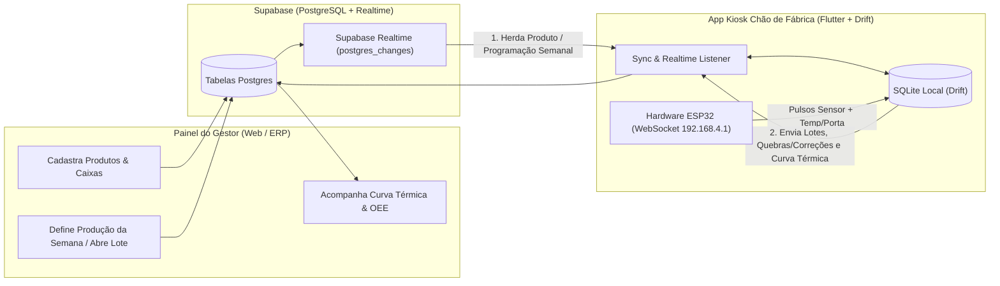

# Especificação de Integração Supabase — G&M Fábrica Monitoramento (Kiosk)

Este documento descreve o levantamento completo das informações que o aplicativo **G&M Fábrica Monitoramento** precisa **receber (Downstream)** e **enviar (Upstream)** para o **Supabase**, incluindo a regra de **Herança de Produção Semanal/Remota** aberta pelo gestor e o mapeamento direto com o banco local **SQLite (Drift)** do Kiosk.

---

## 1. Visão Geral da Arquitetura (Híbrida: Remota + Offline-First)

O Kiosk da fábrica opera em regime **Offline-First** sobre SQLite (`Drift`), onde todas as tabelas locais possuem:
- `id` (`TEXT` / `UUID` gerado no cliente ou herdado do Supabase)
- `sync_status` (`synced`, `creating`, `updating`, `deleting`, `error`)



---

## 2. O que o App RECEBE do Supabase (Gestor → Kiosk)

### 2.1. Catálogo de Produtos (`products`)
Tabela gerenciada pelo gestor. Define os ovos produzidos na fábrica, gramatura, capacidade padrão da caixa e tempo base sugerido de freezer.

| Coluna (Supabase) | Tipo Postgres | Coluna Local (`ProductsTable`) | Obrigatório | Descrição |
| :--- | :--- | :--- | :---: | :--- |
| `id` | `uuid` (PK) | `id` | Sim | Identificador único do produto |
| `sku` | `text` | *(novo campo sugerido)* | Não | Código interno do produto no ERP (ex.: `OVO-LEITE-500`) |
| `name` | `text` | `name` | Sim | Nome exibido no Kiosk (ex.: *"Ovo Ao Leite 500g"*) |
| `unit_weight_grams` | `int4` | `unitWeightGrams` | Sim | Peso unitário em gramas (ex.: `500`, `250`) |
| `default_box_capacity` | `int4` | *(derivado hoje; persistir)* | Sim | Quantidade de ovos que fecham 1 caixa (ex.: `40` ou `50`) |
| `default_cooling_seconds` | `int4` | *(opcional)* | Não | Tempo padrão inicial de cristalização no freezer (ex.: `1200` = 20 min) |
| `is_active` | `boolean` | *(novo campo sugerido)* | Sim | Define se o produto está ativo para seleção no chão de fábrica |
| `updated_at` | `timestamptz` | — | Sim | Data da última atualização para sincronização incremental |

---

### 2.2. Programação Semanal / Ordem de Produção Remota (`production_schedules`)
Permite que o **gestor programe a produção da semana ou abra a produção remotamente pelo Supabase**, fazendo com que o Kiosk **herde automaticamente** o produto ativo sem que o operador precise ficar abrindo e fechando lote manualmente.

| Coluna (Supabase) | Tipo Postgres | Obrigatório | Descrição |
| :--- | :--- | :---: | :--- |
| `id` | `uuid` (PK) | Sim | ID da programação / Ordem de Produção (OP) |
| `product_id` | `uuid` (FK → `products.id`) | Sim | Produto que deve ser produzido |
| `title` | `text` | Não | Identificação da programação (ex.: *"Semana 46 - Linha Ao Leite"*) |
| `status` | `text` | Sim | `'scheduled'` (agendada), `'active'` (em produção agora), `'paused'`, `'completed'`, `'cancelled'` |
| `valid_from` | `timestamptz` | Sim | Início da vigência da programação (ex.: Segunda-feira 07:00) |
| `valid_until` | `timestamptz` | Não | Fim previsto da vigência (ex.: Sexta-feira 18:00) |
| `target_eggs` | `int4` | Não | Meta de ovos líquidos para a semana/turno (opcional, exibe meta no Kiosk) |
| `target_boxes` | `int4` | Não | Meta de caixas fechadas para a semana/turno |
| `auto_start_on_kiosk` | `boolean` | Sim | Se `true`, o Kiosk abre/assume o lote automaticamente assim que receber status `'active'` ou entrar na janela `valid_from`..`valid_until` |
| `allow_operator_override` | `boolean` | Sim | Se `true` (padrão), permite ao operador encerrar/trocar manualmente em caso de imprevisto; se `false`, trava a troca manual no Kiosk |
| `priority` | `int4` | Sim | Prioridade caso exista mais de uma programação na semana (default `0`) |
| `created_by` | `uuid` / `text` | Não | Usuário/gestor que cadastrou a programação |
| `updated_at` | `timestamptz` | Sim | Timestamp de controle |

#### Regras de Negócio da Herança de Produção (`production_schedules` → Kiosk)
1. **Abertura Automática pelo Gestor:**
   - Quando o gestor muda `status = 'active'` no Supabase (ou quando o relógio entra no intervalo `valid_from`..`valid_until` de uma programação com `auto_start_on_kiosk = true`), o Kiosk recebe o evento via **Supabase Realtime** (ou na sincronização ao ligar o tablet).
   - Se **não houver lote aberto** no Kiosk, o app cria automaticamente o registro em `ProductionBatchesTable` vinculado ao `product_id` da programação e captura o `initialHardwareCount` atual do ESP32.
   - Se **já houver um lote aberto de outro produto** e o gestor ativar uma nova programação prioritária, o Kiosk encerra o lote anterior registrando o `finalHardwareCount` e inicia imediatamente o lote do novo produto herdado.
2. **Continuidade Durante a Semana:**
   - Enquanto a programação semanal estiver `active`, mesmo que o tablet seja reiniciado à noite ou entre turnos, ao religar ele reconhece a programação ativa e **continua no mesmo lote/produto** sem exigir ação do operador.
3. **Modo Manual (Fallback no Chão de Fábrica):**
   - Se não houver programação ativa no Supabase (ou se a fábrica estiver sem internet), o operador continua podendo iniciar e encerrar lotes manualmente no tablet (respeitando a trava de **não permitir iniciar outro produto sem encerrar o lote atual**).

---

### 2.3. Configuração dos Freezers e Calibrações (`freezers` & `freezer_calibrations`)
Permite que o gestor ajuste os parâmetros térmicos das câmaras frias e que o tempo ideal calibrado por produto/freezer seja compartilhado na nuvem.

#### Tabela `freezers` (Espelha `FreezersTable` + Tempos do Sensor de Porta)
| Coluna (Supabase) | Tipo Postgres | Coluna Local (`FreezersTable`) | Descrição |
| :--- | :--- | :--- | :--- |
| `id` | `text` (PK) | `id` | `'freezer_1'` ou `'freezer_2'` |
| `name` | `text` | `name` | Nome de exibição (ex.: *"Freezer 01"*, *"Freezer 02"*) |
| `target_temperature` | `float8` | `targetTemperature` | Setpoint ideal (ex.: `4.0` °C) |
| `critical_temperature` | `float8` | *(constante hoje: `8.0`)* | Limite para alarme crítico de temperatura |
| `max_door_open_seconds` | `int4` | *(constante hoje: `60`)* | Tempo máximo de porta aberta antes do alarme sonoro/visual |
| `inspection_threshold_seconds` | `int4` | `inspectionThresholdSeconds` (`12`) | Porta aberta abaixo disso (quando vazio) é ignorada como inspeção rápida |
| `unload_min_seconds` | `int4` | `unloadMinSeconds` (`30`) | Tempo mínimo de porta aberta para considerar **Só Retirada das Formas** (ex.: `30s a 59s`). Se abrir menos que isso com lote pronto (ex.: `15s`), entende que foi **verificação e ainda está mole (+3 min)** |
| `reload_min_seconds` | `int4` | `reloadMinSeconds` (`60`) | Tempo mínimo de porta aberta para considerar **Retirou + Já Abasteceu Novo Lote** (`>= 60s`), reiniciando a contagem automaticamente ao fechar a porta |

#### Tabela `freezer_calibrations` ( Bidirecional — Espelha `FreezerCalibrationsTable`)
| Coluna (Supabase) | Tipo Postgres | Coluna Local (`FreezerCalibrationsTable`) | Descrição |
| :--- | :--- | :--- | :--- |
| `id` | `uuid` (PK) | `id` | Identificador da calibração |
| `freezer_id` | `text` (FK) | `freezerId` | `'freezer_1'` ou `'freezer_2'` |
| `product_id` | `uuid` (FK) | `productId` | Produto calibrado |
| `calibrated_duration_seconds` | `int4` | `calibratedDurationSeconds` | Tempo ideal aprendido pelo algoritmo (ex.: `1140` seg) |
| `sample_count` | `int4` | `sampleCount` | Quantidade de bateladas avaliadas que formaram a média |
| `last_feedback` | `text` | `lastFeedback` | `'tooEarly'`, `'ideal'`, `'tooLate'`, `'aborted'` |
| `updated_at` | `timestamptz` | `updatedAt` | Última atualização |

---

## 3. O que o App ENVIA para o Supabase (Kiosk → Nuvem)

Todas as tabelas abaixo são gravadas primeiro no SQLite local (`syncStatus = creating` ou `updating`) e enviadas em lote/fila para o Supabase assim que houver conexão.

### 3.1. Lotes de Produção Executados (`production_batches`)
Espelha `ProductionBatchesTable` somado aos consolidados contábeis para facilitar relatórios e dashboards do gestor no Supabase.

| Coluna (Supabase) | Tipo Postgres | Origem Local (`ProductionBatchesTable` + DAO) | Descrição |
| :--- | :--- | :--- | :--- |
| `id` | `uuid` (PK) | `id` | UUID do lote |
| `schedule_id` | `uuid` (FK, null) | *(novo campo)* | ID da `production_schedules` se foi herdado do Supabase, ou `null` se aberto manualmente no Kiosk |
| `origin` | `text` | *(novo campo)* | `'remote_schedule'` (aberto pelo gestor) ou `'manual_kiosk'` (aberto pelo operador) |
| `product_id` | `uuid` (FK) | `productId` | Produto produzido no lote |
| `initial_hardware_count` | `int4` | `initialHardwareCount` | Contador absoluto do ESP32 no momento da abertura do lote |
| `final_hardware_count` | `int4` (null) | `finalHardwareCount` | Contador absoluto do ESP32 no encerramento (ou último pulso sincronizado) |
| `gross_count` | `int4` | Calculado (`ProductionDao`) | Total bruto lido pelo sensor da esteira no lote |
| `discards_count` | `int4` | Calculado (`ProductionDao`) | Total de ovos subtraídos por quebra/descarte |
| `manual_additions_count` | `int4` | Calculado (`ProductionDao`) | Total de ovos adicionados via **Correção manual** (não lidos pelo sensor) |
| `net_count` | `int4` | Calculado (`ProductionDao`) | **Produção Líquida Real** (`gross_count - discards_count + manual_additions_count`) |
| `completed_boxes` | `int4` | Calculado (`ProductionDao`) | Quantidade de caixas fechadas (`net_count ~/ box_capacity`) |
| `started_at` | `timestamptz` | `startedAt` | Data/hora de início do lote |
| `finished_at` | `timestamptz` (null) | `finishedAt` | Data/hora de encerramento (`null` enquanto o lote estiver aberto) |

---

### 3.2. Lançamentos de Quebra e Correção Manual (`batch_adjustments`)
Espelha `BatchAdjustmentsTable`. Registra cada lançamento feito pelo operador no modal **"Lançar Ajuste / Quebra"**.

| Coluna (Supabase) | Tipo Postgres | Coluna Local (`BatchAdjustmentsTable`) | Descrição |
| :--- | :--- | :--- | :--- |
| `id` | `uuid` (PK) | `id` | UUID do lançamento |
| `batch_id` | `uuid` (FK) | `batchId` | Lote ao qual pertence o ajuste |
| `delta_qty` | `int4` | `deltaQty` | **Negativo (`-1`, `-2`, `-N`)** para quebras/descartes;<br>**Positivo (`+1`, `+2`, `+N`)** quando `reason = 'manualCorrection'` |
| `reason` | `text` | `reason` (`AdjustmentReasonEnum`) | Valores: `'brokenPacking'` (Quebra na embalagem), `'melting'` (Derretimento), `'fallingBelt'` (Queda na esteira), `'qualityFail'` (Falha de qualidade), `'manualCorrection'` (Correção manual - Soma) |
| `observation` | `text` (null) | `observation` | Observação opcional |
| `created_at` | `timestamptz` | `createdAt` | Data/hora exata do lançamento |

---

### 3.3. Ciclos de Cristalização dos Freezers (`cooling_cycles`)
Espelha `CoolingCyclesTable`. Envia o histórico de cada batelada colocada nos Freezers 01 e 02, incluindo o impacto térmico da abertura de porta e o feedback do operador.

| Coluna (Supabase) | Tipo Postgres | Coluna Local (`CoolingCyclesTable`) | Descrição |
| :--- | :--- | :--- | :--- |
| `id` | `uuid` (PK) | `id` | UUID do ciclo de resfriamento |
| `batch_id` | `uuid` (FK, null) | `batchId` | Lote ativo no momento da batelada |
| `freezer_id` | `text` (FK) | `freezerId` | `'freezer_1'` ou `'freezer_2'` |
| `started_at` | `timestamptz` | `startedAt` | Início do ciclo (fechamento da porta após abastecer) |
| `finished_at` | `timestamptz` (null) | `finishedAt` | Fim do ciclo (retirada da batelada) |
| `baseline_temp` | `float8` | `baselineTemp` | Temperatura base antes de abrir a porta (ex.: `3.8` °C) |
| `initial_peak_temp` | `float8` | `initialPeakTemp` | Pico de temperatura atingido logo após fechar a porta (ex.: `7.4` °C) |
| `expected_duration_seconds` | `int4` | `expectedDurationSeconds` | Tempo previsto inicial para cristalização |
| `actual_duration_seconds` | `int4` (null) | `actualDurationSeconds` | Tempo real decorrido até a retirada |
| `accumulated_door_open_seconds` | `int4` | `accumulatedDoorOpenSeconds` | Total de segundos com porta aberta durante o ciclo |
| `accumulated_penalty_seconds` | `int4` | `accumulatedPenaltySeconds` | Segundos extras adicionados ao timer por perda térmica de porta aberta |
| `door_open_count` | `int4` | `doorOpenCount` | Quantas vezes a porta foi aberta durante o ciclo |
| `feedback` | `text` (null) | `feedback` (`CycleFeedbackEnum`) | Avaliação do operador ao retirar: `'tooEarly'`, `'ideal'`, `'tooLate'`, `'aborted'` |

---

### 3.4. Eventos Térmicos, Curva de Recuperação e Linha do Tempo (`freezer_events`, `room_events`, `production_timelines`)
Para alimentar gráficos de **Curva Térmica Pós-Porta**, **Clima da Sala (4x4m)** e **Velocidade da Esteira** no painel do gestor sem saturar o banco com envios a cada 1 segundo:

#### 1. `freezer_events` (Espelha `FreezerEventsTable`)
Enviado apenas nos gatilhos inteligentes já implementados no repositório:
- `id` (`uuid`, PK)
- `freezer_id` (`text` — `'freezer_1'` ou `'freezer_2'`)
- `batch_id` (`uuid`, nullable)
- `recorded_at` (`timestamptz`)
- `temperature` (`float8` — temperatura em °C)
- `is_door_open` (`boolean` — estado da porta no instante do evento)
- `trigger_reason` (`text` — `'periodic_5m'`, `'door_change'`, `'temp_spike'`)

#### 2. `room_events` (Espelha `RoomEventsTable`)
Monitoramento da sala climatizada 4x4m (faixa ideal: `18 °C a 21 °C` e umidade `<= 50%`):
- `id` (`uuid`, PK)
- `batch_id` (`uuid`, nullable)
- `recorded_at` (`timestamptz`)
- `temperature` (`float8`)
- `humidity` (`float8`)

#### 3. `production_timelines` (Espelha `ProductionTimeLinesTable`)
Snapshots periódicos do contador da esteira para cálculo de ritmo (ovos/minuto e ovos/hora):
- `id` (`uuid`, PK)
- `batch_id` (`uuid`, FK)
- `current_hardware_count` (`int4`)
- `recorded_at` (`timestamptz`)

---

## 4. Script SQL Pronto para o Supabase (Migration Inicial)

Você pode copiar e executar o script abaixo diretamente no **SQL Editor** do Supabase para criar toda a estrutura com suporte a **Supabase Realtime**:

```sql
-- 1. Tabela de Produtos
create table if not exists public.products (
  id uuid primary key default gen_random_uuid(),
  sku text unique,
  name text not null,
  unit_weight_grams int4 not null check (unit_weight_grams > 0),
  default_box_capacity int4 not null default 50 check (default_box_capacity > 0),
  default_cooling_seconds int4 not null default 1200,
  is_active boolean not null default true,
  created_at timestamptz not null default now(),
  updated_at timestamptz not null default now()
);

-- 2. Programação Semanal / Ordem de Produção Remota (Gestor -> Kiosk)
create table if not exists public.production_schedules (
  id uuid primary key default gen_random_uuid(),
  product_id uuid not null references public.products(id) on delete restrict,
  title text,
  status text not null default 'scheduled'
    check (status in ('scheduled', 'active', 'paused', 'completed', 'cancelled')),
  valid_from timestamptz not null default now(),
  valid_until timestamptz,
  target_eggs int4,
  target_boxes int4,
  auto_start_on_kiosk boolean not null default true,
  allow_operator_override boolean not null default true,
  priority int4 not null default 0,
  created_by text,
  created_at timestamptz not null default now(),
  updated_at timestamptz not null default now()
);

-- 3. Configuração dos Freezers (incluindo Tempos do Sensor de Porta)
create table if not exists public.freezers (
  id text primary key,
  name text not null,
  target_temperature float8 not null default 4.0,
  critical_temperature float8 not null default 8.0,
  max_door_open_seconds int4 not null default 60,
  inspection_threshold_seconds int4 not null default 12,
  unload_min_seconds int4 not null default 30,
  reload_min_seconds int4 not null default 60,
  updated_at timestamptz not null default now()
);

-- 4. Calibração Aprendida por Freezer + Produto
create table if not exists public.freezer_calibrations (
  id uuid primary key default gen_random_uuid(),
  freezer_id text not null references public.freezers(id) on delete cascade,
  product_id uuid not null references public.products(id) on delete cascade,
  calibrated_duration_seconds int4 not null,
  sample_count int4 not null default 1,
  last_feedback text check (last_feedback in ('tooEarly', 'ideal', 'tooLate', 'aborted')),
  updated_at timestamptz not null default now(),
  unique (freezer_id, product_id)
);

-- 5. Lotes de Produção Executados (Kiosk -> Supabase)
create table if not exists public.production_batches (
  id uuid primary key,
  schedule_id uuid references public.production_schedules(id) on delete set null,
  origin text not null default 'manual_kiosk'
    check (origin in ('remote_schedule', 'manual_kiosk')),
  product_id uuid not null references public.products(id) on delete restrict,
  initial_hardware_count int4 not null,
  final_hardware_count int4,
  gross_count int4 not null default 0,
  discards_count int4 not null default 0,
  manual_additions_count int4 not null default 0,
  net_count int4 not null default 0,
  completed_boxes int4 not null default 0,
  started_at timestamptz not null,
  finished_at timestamptz,
  updated_at timestamptz not null default now()
);

-- 6. Ajustes de Lote: Quebras (-) e Correções Manuais (+)
create table if not exists public.batch_adjustments (
  id uuid primary key,
  batch_id uuid not null references public.production_batches(id) on delete cascade,
  delta_qty int4 not null check (delta_qty <> 0),
  reason text not null
    check (reason in ('brokenPacking', 'melting', 'fallingBelt', 'qualityFail', 'manualCorrection')),
  observation text,
  created_at timestamptz not null default now()
);

-- 7. Ciclos de Cristalização dos Freezers
create table if not exists public.cooling_cycles (
  id uuid primary key,
  batch_id uuid references public.production_batches(id) on delete set null,
  freezer_id text not null references public.freezers(id) on delete restrict,
  started_at timestamptz not null,
  finished_at timestamptz,
  baseline_temp float8 not null,
  initial_peak_temp float8 not null,
  expected_duration_seconds int4 not null,
  actual_duration_seconds int4,
  accumulated_door_open_seconds int4 not null default 0,
  accumulated_penalty_seconds int4 not null default 0,
  door_open_count int4 not null default 0,
  feedback text check (feedback in ('tooEarly', 'ideal', 'tooLate', 'aborted'))
);

-- 8. Eventos Térmicos e Porta dos Freezers (Curva de Recuperação)
create table if not exists public.freezer_events (
  id uuid primary key,
  freezer_id text not null references public.freezers(id) on delete cascade,
  batch_id uuid references public.production_batches(id) on delete set null,
  recorded_at timestamptz not null,
  temperature float8 not null,
  is_door_open boolean not null,
  trigger_reason text not null
    check (trigger_reason in ('periodic_5m', 'door_change', 'temp_spike'))
);

-- 9. Eventos Climáticos da Sala 4x4m
create table if not exists public.room_events (
  id uuid primary key,
  batch_id uuid references public.production_batches(id) on delete set null,
  recorded_at timestamptz not null,
  temperature float8 not null,
  humidity float8 not null
);

-- 10. Linha do Tempo de Velocidade da Esteira
create table if not exists public.production_timelines (
  id uuid primary key,
  batch_id uuid not null references public.production_batches(id) on delete cascade,
  current_hardware_count int4 not null,
  recorded_at timestamptz not null
);

-- Habilitar Supabase Realtime para as tabelas que o Kiosk escuta ao vivo
alter publication supabase_realtime add table public.products;
alter publication supabase_realtime add table public.production_schedules;
alter publication supabase_realtime add table public.freezers;
alter publication supabase_realtime add table public.freezer_calibrations;

-- 11. Bucket no Supabase Storage para Backups (.zip) do Banco SQLite Local
insert into storage.buckets (id, name, public)
values ('database-backups', 'database-backups', false)
on conflict (id) do nothing;

create policy "Permitir upload de backups pelo Kiosk autenticado"
  on storage.objects for insert
  to authenticated
  with check (bucket_id = 'database-backups');

create policy "Permitir atualização de backups pelo Kiosk autenticado"
  on storage.objects for update
  to authenticated
  using (bucket_id = 'database-backups');

create policy "Permitir leitura de backups por usuários autenticados"
  on storage.objects for select
  to authenticated
  using (bucket_id = 'database-backups');
```

---

## 5. Exemplos de Payloads JSON

### 5.1. Recebido pelo App quando o Gestor ativa a Produção da Semana (`production_schedules`)
```json
{
  "id": "8f14e45f-ceea-467f-a8f8-153c92b0c9d1",
  "product_id": "prod_ovo_500",
  "title": "Produção Semana 46 - Ovo Ao Leite 500g",
  "status": "active",
  "valid_from": "2026-11-16T07:00:00-03:00",
  "valid_until": "2026-11-21T18:00:00-03:00",
  "target_eggs": 4000,
  "target_boxes": 100,
  "auto_start_on_kiosk": true,
  "allow_operator_override": true,
  "priority": 10
}
```

### 5.2. Enviado pelo App ao registrar Quebra (`-`) ou Correção Manual (`+`) (`batch_adjustments`)
```json
[
  {
    "id": "a19c02d4-39e0-49f1-9c12-71c80f9b2201",
    "batch_id": "b47ac10b-58cc-4372-a567-0e02b2c3d479",
    "delta_qty": -2,
    "reason": "brokenPacking",
    "observation": null,
    "created_at": "2026-11-15T10:12:00-03:00"
  },
  {
    "id": "c72e19a8-81b2-4e0c-b411-99210a4d8812",
    "batch_id": "b47ac10b-58cc-4372-a567-0e02b2c3d479",
    "delta_qty": 2,
    "reason": "manualCorrection",
    "observation": "Sensor não contou 2 ovos que passaram juntos",
    "created_at": "2026-11-15T10:14:30-03:00"
  }
]
```
